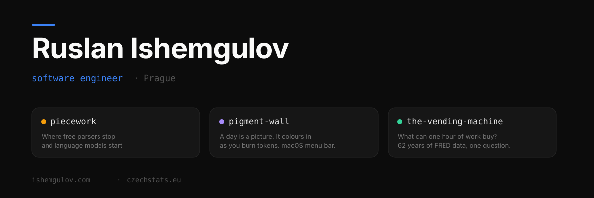
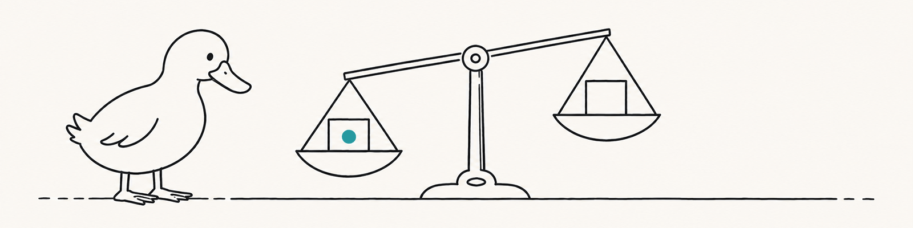

<!--
<p align="center">
  
</p>
-->

<!--
```
  __
<(o )___     Measured, not believed.
 ( ._> /
  `---'
```
-->

<picture>
  <source media="(prefers-color-scheme: dark)" srcset="assets/readme/hero-duck-dark-adj.png">
  
</picture>

# Ruslan Ishemgulov

Web Technical Lead. I test how AI coding agents behave, and build small tools for economics and investing.

## Products

| Product | What it is |
|---|---|
| [Czechonomics](https://czechonomics.com) | Key indicators, financial data and government stats for the Czech economy. Web and iOS. |
| [Assumio](https://assumio.com) | A private ledger of investment reasoning. Grade the thesis, not the returns. |
| [The Delisted](https://thedelisted.com) | Dead companies, filed as cold cases. |

## Experiments on AI coding agents

| Experiment | The finding |
|---|---|
| [Don't](https://github.com/rutrader/dont) | Delete a rule and the model breaks it on 55% of comments. Said backwards: 17%. Said forwards: 5%. [What 'never' costs](https://ishemgulov.com/writing/what-never-costs) |
| [Piecework](https://github.com/rutrader/piecework) | A free parser handled three of four kinds of break in WordPress/gutenberg. [What the typechecker can't see](https://ishemgulov.com/writing/what-the-typechecker-cant-see) |
| [Half-life](https://github.com/rutrader/half-life) | A "never" rule, ~100k tokens of code later, still held. [The rule that didn't fade](https://ishemgulov.com/writing/half-life) |

More: [ishemgulov.com](https://ishemgulov.com)
